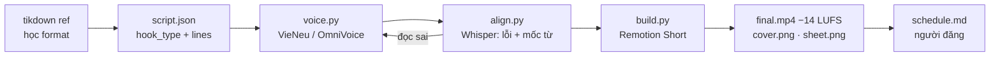

# 1 · TikTok faceless giọng AI chạy được

Video 9:16 không lộ mặt: mẹo tech, nỗi đau → app, trend-remix. Skill **`tt-short`**. Mẫu: `videos/ACTIVE/tt-01` → `tt-07`.

## Công cụ trong luồng này

| Khâu | Xài gì | Ghi chú |
|---|---|---|
| Học trend | `tikdown.py ref` · `tiktrend.py` (yt-dlp, curl_cffi) | chỉ để **học format**, không cắt vào video |
| Kịch bản | `script.json` theo 6 công thức hook | `build.py` tự lint hook |
| Giọng VI | **VieNeu-TTS v3 Turbo** (48 kHz, 25 giọng: Hải Đăng, Adam bựa, Trúc Ly…) | chạy GPU, venv `D:/ai-tts/vieneu` |
| Giọng EN | **OmniVoice** — câu đầu *voice design* theo mô tả, các câu sau *clone* | một giọng suốt video, lưu `voice.pt` |
| Nghe lại | **Whisper large-v3-turbo** (`align.py`) | WER + mốc giây từng từ |
| Nhạc + SFX | `music.py` tự tổng hợp: pop · chill · drive + whoosh/pop/ding | không bản quyền |
| Render | **Remotion** composition `Short` (`lib/remotion/src/Short.tsx`) | 1080×1920, h264 crf 18 |
| Font | **Be Vietnam Pro** 600/800/900 | có dấu tiếng Việt |
| Âm lượng | ffmpeg `loudnorm` −14 LUFS, TP −1.5 | 2 lượt đo |
| Outro | `outro.py` (Pillow + edge-tts hoặc giọng đã render) | Impact / Segoe UI Black |

## Các bước

## Các kiểu cảnh (`kind`) có sẵn

| kind | Trông ra sao |
|---|---|
| `hook` | emoji to + tiêu đề 2 dòng, punch-zoom + flash trắng |
| `keys` | phím tắt dạng phím thật, lún xuống + glow màu accent |
| `steps` | đường dẫn menu từng bước, mũi tên ↓, nảy lần lượt |
| `files` | danh sách file có icon + nhãn đỏ |
| `meme` | màn chữ trên/dưới, im lặng |
| `clip` | cửa sổ app 16:10 từ quay màn hình thật, zoom vào `focus`, nhãn bật |
| `cta` | icon app nảy + nút |
| `react` / `green` | duet chỉ tay 👈 · green screen ảnh comment |
| `memehook` / `phone` | dùng cho luồng [hook-action](02-hook-action.md) |

Phụ đề karaoke chạy trên mọi cảnh (trừ `memehook`), từ đang đọc to hơn 11% và đổi màu accent.

## Ai làm gì

- **Claude:** kịch bản, giọng, Whisper, render, nhìn `sheet.png`, viết `schedule.md`.
- **Bạn:** quay màn hình app thật, duyệt kịch bản, đăng trong TikTok Studio, bật nhãn quảng cáo khi quảng bá app.
