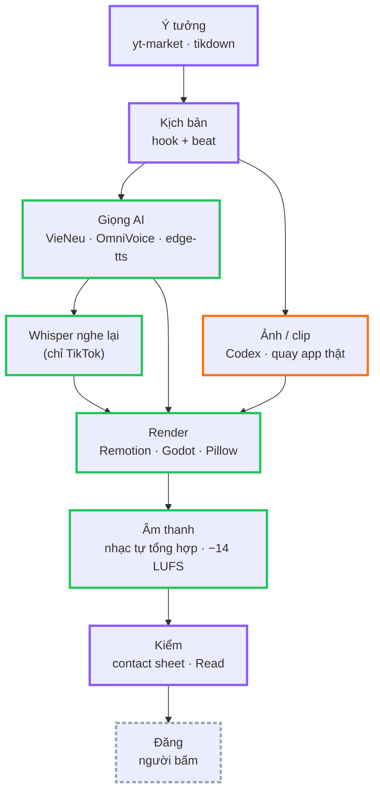

# Trả lời nhanh

> Mấy câu hay mù mờ nhất, mỗi câu một dòng — bấm "Đọc thêm" để vào trang chi tiết.

| Câu hỏi | Trả lời ngắn | Đọc thêm |
|---|---|---|
| Giọng đọc dùng gì? | **Tiếng Việt TikTok → VieNeu-TTS** · **Tiếng Anh TikTok → OmniVoice** · hoạt hình, tóm tắt truyện, video app → **edge-tts** (giọng Microsoft, miễn phí, cần mạng) | [Giọng đọc](../stack/giong-tts.md) |
| Whisper là gì, để làm gì? | Model **nghe lại** file giọng AI vừa đọc: bắt chỗ đọc sai chữ + lấy **mốc giây từng từ** để làm phụ đề karaoke. Chỉ luồng TikTok dùng | [Whisper](../stack/whisper.md) |
| Text-to-speech khác Whisper sao? | TTS = **chữ → tiếng**. Whisper = **tiếng → chữ** (ngược lại). Luồng TikTok dùng cả hai: TTS đọc, Whisper kiểm | [Thuật ngữ](thuat-ngu.md) |
| Kịch bản viết theo method nào? | TikTok: **6 công thức hook** + luật 3 giây · Hoạt hình: **beat trước, thoại sau** (hook → setup → twist → punchline) · Recap: hook ≤ 15 s, mỗi chương kết câu treo | [Kịch bản](../stack/kich-ban.md) |
| Render bằng gì? | **Remotion** (React → MP4) cho TikTok, recap, video app · **Godot 4** / **Python Pillow** cho hoạt hình cutout · Manim / wiggle cho đồ hoạ phụ | [Render engine](../stack/render-engine.md) |
| HyperFrames thì sao? | **Chưa dùng ở đâu cả.** Là đối thủ của Remotion (HTML + GSAP → MP4, của HeyGen). Không đổi lúc này | [Remotion vs HyperFrames](../stack/render-engine.md#remotion-hay-hyperframes) |
| Font chữ? | **Be Vietnam Pro** (TikTok + recap) · **Pangolin** (chữ viết tay trong recap) · **Impact / Segoe UI Black** (outro, chữ trên ảnh) · font hệ thống Apple (video app) | [Font & hiệu ứng](../stack/font-hieu-ung.md) |
| Hiệu ứng là gì? | Code tay trong Remotion: `spring` bật nảy, rung màn, flash trắng, zoom chậm (Ken Burns), phụ đề sáng từng từ, phím bấm lún + glow | [Font & hiệu ứng](../stack/font-hieu-ung.md#hieu-ung) |
| Nhạc lấy đâu? | **Tự tổng hợp bằng code** (`music.py`, numpy) → không dính bản quyền. Nhạc trend gắn trong app TikTok lúc đăng | [Âm thanh](../stack/am-thanh.md) |
| Ảnh / video AI? | Claude **chỉ viết prompt**, **Codex** sinh ảnh; cảnh chêm video dùng **Veo / Kling** chạy ngoài | [Ảnh & video AI](../stack/anh-video-ai.md) |

## Một video đi qua những gì

Viền tím = Claude viết/kiểm · viền xanh lá = công cụ chạy trên máy · viền cam = Codex / dịch vụ ngoài · viền xám đứt = người làm.

!!! tip "Luật chung mọi luồng"
    - **Giọng là xương sống:** độ dài cảnh lấy theo độ dài giọng đo thật, không tăng tốc giọng cho vừa.
    - **Chưa nhìn contact sheet thì chưa xong.**
    - Claude **không tự vẽ ảnh** — viết prompt, Codex sinh.
    - Không cắt video người khác vào bản dựng — trend thì Stitch / Duet trong app.
